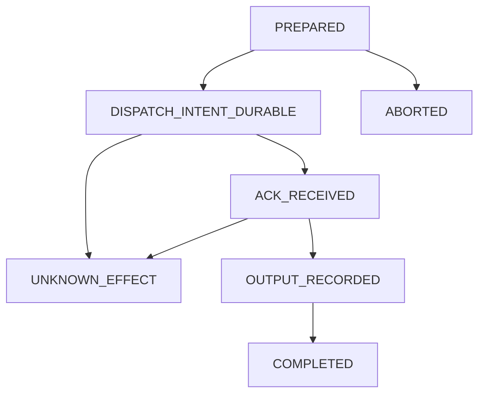

# Private TRAIN worker dispatch: source-only contract v1

**Status: SOURCE ONLY / DEV ONLY — not a deployed worker or a functioning distributed trainer.**

This module describes a bounded subordinate actuator within the original Labyrinth saga. The learner enters with a real, captured W0; the taskmaster proposes development chambers; independent TRAIN-side validation authorizes a challenge; and a real trainer may later produce Wt. The Minotaur must judge measured model behavior, not adventure choices or the worker's self-reported result. Ariadne must link the entrance, challenges, checkpoint transitions and verdict. This contract covers **only** preparing and journaling one approved TRAIN work unit for future execution on a privately connected worker.

## Typed contract

The additive, standard-library-only `labyrinth.private_worker_dispatch` module defines:

| Type | Bounded source contract |
| --- | --- |
| `ArtifactPart`, `ModelSnapshot` | W0 closure of named, relative and hash-pinned model weight shard(s), sharded weight index when necessary, `config.json`, tokenizer file(s), and paired adapter files when present; exact entrance manifest/state digests. Max 128 files, explicit sizes and roles. |
| `ApprovedTrainWork` | Objective, approved TRAIN manifest/source receipt digests, predecessor checkpoint and predecessor worker-receipt chain, cycle 0–7, 1–128 chambers. A non-TRAIN split is rejected. |
| `IdleGpuLease` | Bounded source declaration of an intended Lappy CUDA resource/idle lease, with nonce and expiry no later than ten minutes after issue. **Not** a real idle-host measurement. |
| `PrivateTrainJob` | VN1 coordinator, Lappy worker, future private LAN/Tailscale route, attempt nonce, full W0 snapshot digest and TRAIN work. Stable idempotency key excludes changing nonce/lease and prevents laundering an uncertain attempt through another job ID. Full JSON budget: 64 KiB. |
| `WorkerOutputReceipt` | Unsigned, source-level worker self-report bound to one job, lease, predecessor, result and chamber count; explicit `WORKER_SELF_REPORTED_UNVERIFIED` classification. Different result digest is **not** evidence of improved skills or even changed physical weights. |
| `LocalDispatchWAL` | No-overwrite, fsynced per-transition local intent records. Prevents blind resend after an intent might have left VN1, even when the effect is unknown. |

Only relative, portable artifact identifiers appear in jobs. No arbitrary host path, executable, shell command, prompt, case ID, private exam item, gold answer, token or transport credential is accepted as a field. Actual user-owned file movement, permissions and execution require a separate, authorized implementation.

## Local write-ahead lifecycle



`DISPATCH_INTENT_DURABLE` **precedes** any eventual network send. This module never sends. Source `COMPLETED` means the matching *unsigned receipt* was recorded, not that checkpoint provenance or learning has been independently verified. Once send intent exists, `retry_authorized()` is false; the operator or future reconciliation protocol must resolve a lost reply before any retry. Hash-chained event files are reread on state transitions and recreation. Altered, missing, extra, cross-job or non-contiguous event slots stop progress. Hashes do not provide a trusted external witness against an attacker able to rewrite the entire local directory.

## The critical integration bridge, still unimplemented

1. **Admission / W0**: VN1 calls `entrance_state_v1.verify_entrance_state` (not merely parses a digest), pins every real model file, stores training-safe baseline measurements and checks the source/rights grant. The worker independently rehashes received full W0 bytes before use.
2. **Chamber**: existing `minotaur_model` taskmaster proposal and `journey_policy_runner` TRAIN feedback approve a bounded executable learner update; model-created scenes are validated before any GPU effect. No private EXAM or graduation material enters a job.
3. **Dispatch**: future authenticated, private transport checks Lappy identity, actual idle/resource lease and work-unit approval, persists send intent, then sends **once** under an effect-reconciliation protocol. VN1 remains coordinator; NAS custody is optional. Nothing here probes, starts or contacts a host.
4. **Train and receipt**: worker retains the predecessor, performs a real neural step, writes new weights/adapter and, for exact resume, optimizer/scheduler/RNG state with independent file hashes and immutable locations. It returns a signed or authenticated receipt with actual output artifact inventory, not just a claimed digest.
5. **Ariadne / Minotaur**: verified W0→Wt evidence flows to saga receipts and the Ariadne event chain. Minotaur receives **held-out** behavior measurements and computes its existing thresholds. Failure regenerates training challenges targeting observed weaknesses, not merely a new random story. Private evaluation remains isolated.

Do not connect the receipt to `SagaSession` as proof of trained weights until step 4 is real. The present worker contract does not load models, contact Lappy/VN1/NAS, enforce filesystem custody on either host, train weights, attest an idle GPU, authenticate peers, replace a resumable checkpoint protocol, guarantee cross-process coordination under hostile concurrency, or establish Minotaur improvement. The intended system remains $0 and local/private-network only.

## Offline qualification

```bash
python -m unittest -q tests.test_private_worker_dispatch
```

Tests use a deliberately non-neural mock worker; green results prove serialization, bounds, local WAL sequencing and fail-closed invariants under tested inputs only.
