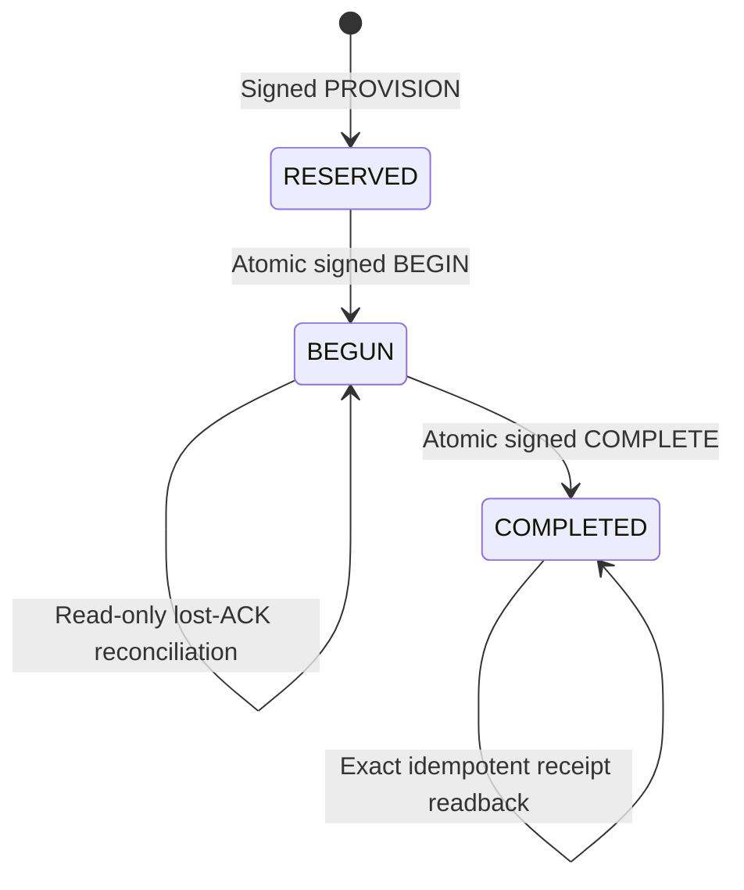

# Q6 durable exposure-slot authority: SOURCE-ONLY R120

**Disposition:** implemented and locally adversarial-tested service core, **not**
an installed independent host authority, a protected private evaluator, or an
admitted Q6 physical campaign. Q5–Q9/HQ training and graduation remain **HOLD**.

## Ownership and scope

`labyrinth/q6_durable_slot_authority_r120.py` is a standalone
operator-side SQLite service core, not another in-memory trainer wrapper.
`labyrinth/q6_durable_slot_unix_r120.py` is a runnable Linux AF_UNIX adapter.
It imports the existing source authority's strict bounded canonical-JSON
framing, SO_PEERCRED UID extraction, and socket ancestry checks. An operator
provisions the service constructor with an Ed25519 signing seed, a pinned
campaign-authority public key, a fixed principal/role roster and a private DB
path. **Neither constructor nor `provision_campaign` is on the Unix wire.**
Unix requests omit principal IDs; the service injects a kernel-reported UID's
mapped identity. The socket rejects mapping an operator identity.
It also rejects a source-simulation core or any core with no configured
external witness. The only remotely callable exposure path is therefore
witness-required, though the supplied witness is not independently attested
by this repository.

The local service core:

1. Verifies the separate signed Q6 campaign reservation and public,
   regenerated full-manifest commitment; atomically materializes *all* planned
   slots and appends one signed `PROVISION` event.
2. Uses SQLite WAL, `synchronous=FULL`, `BEGIN IMMEDIATE` transactions,
   immutable slot IDs, a global semantic hash uniqueness constraint across
   runs, completion-nonce uniqueness, and one signed global append-only
   hash-chain head.
3. Commits a per-slot signed `BEGIN` while its state is `RESERVED` before
   returning a receipt. `BEGIN` cannot be repeated. The *actual* protected
   prompt store must separately enforce that receipt-first ordering.
4. In the default **witness-required** database mode, refuses `PROVISION`,
   `BEGIN` or `COMPLETE` without an operator-injected external monotonic
   witness whose readback equals the current DB head. After a local commit,
   it requires the witness's compare-and-advance acknowledgment **before
   returning the BEGIN receipt**. An unavailable, stale, divergent or refusing
   witness produces `OUTCOME_UNKNOWN`, never a reveal authorization. A
   separate operator-only `reconcile_external_anchor` can advance one
   already-signed local event after a lost witness ACK; it cannot produce a
   second BEGIN. Witness requirements and simulation mode are sealed into
   the persisted service configuration and cannot be silently swapped on
   restart.
5. Commits a signed `COMPLETE` from `BEGUN`, binding the result, execution,
   checkpoint and completion nonce commitments. Exact duplicate completion
   reads back its original signature without appending a new event. A changed
   completion is rejected.
6. Uses read-only `reconcile(slot_id)` after an unknown ACK. The operator
   protocol must **never re-expose** an EVAL prompt after a committed BEGIN,
   including if the process crashed before consuming it.
7. Replays and verifies the entire signed journal, materialized slot state,
   campaign signatures, semantic index, and nonce index on restart and before
   each transaction. Missing database on restart, changed signer/roster,
   journal gaps, field tampering and slot-state tampering fail closed.

There is no stored prompt, gold answer, model-execution command, training
capability, graduation endpoint, or key-provisioning endpoint in the Unix API.

## Committed event order

Every event increases the single global commit index and head digest. In
default witness-required mode an external compare-and-advance acknowledgment
is necessary before a fresh BEGIN receipt is returned. The explicit
`allow_unwitnessed_source_simulation=True` mode is a separate config-pinned
toy mode that illustrates local SQLite behavior without asserting any external
authority. Its receipts remain source-only and must never release prompts.
The
campaign reservation's signed epoch/fence remains a separate upstream pin;
the local CAS checks the *global* expected commit index/head. A stale expected
head is rejected before any new BEGIN or COMPLETE, except an exact replay of
an already committed COMPLETE which returns the immutable receipt.

## Executable tests and findings

`python -B -m unittest tests.test_q6_durable_slot_authority_r120 -q`

The 20 source tests cover restart durability, lost BEGIN ACK, lost COMPLETE
ACK, idempotence versus changed payload, stale head, duplicate reveal,
concurrent BEGIN from separate service objects, TRAIN/EVAL role isolation,
forged principal request, Linux `SO_PEERCRED`-bound socket roundtrip,
unmapped UID, forbidden remote provisioning, invalid campaign signature,
cross-run semantic replay, signed receipt alteration, journal and slot-state
tampering, changed signer/roster, and a genuine SQLite snapshot restore.
The witness-required tests use an explicitly untrusted same-process fake to
show missing-witness refusal, preflight rollback rejection, post-commit
compare-and-advance refusal, lost witness ACK, and one-event-only operator
anchor recovery. They do not establish an independently owned witness.

**Rollback result:** a snapshot restored to a *previous internally consistent*
signed journal can still pass local verification in the explicit simulation
mode. The default witnessed path refuses a new BEGIN when the independently
maintained high-water head is newer than the restored database. The module's
`assert_external_head_matches()` is a diagnostic caller-supplied comparison,
**not** the production gate. The production gate invokes the
`Q6IndependentMonotonicWitness` protocol configured by the operator and
requires compare-and-advance ACK after DB commit. The repository provides
**no independent implementation or attestation** of that witness; a same-UID
fake or caller-owned object still defeats its intended trust boundary.

## Deployment requirements still missing

- Independent, root/operator-controlled service account, DB, key, socket,
  UID roster and immutable configuration, all outside the trainer's VM,
  filesystem, credentials and rollback domain. The tests run on one host and
  often one UID and cannot establish this separation.
- A real independently deployed, authenticated and monotonic implementation of
  the already-required external witness interface, including bootstrap,
  compare-and-advance and owner-only recovery. Local DB durability and
  signature verification do not prevent restoring an older *valid* database.
- Host-owned, protected heldout/transfer prompt store and evaluator process
  that checks the exact signed BEGIN and independent high-water witness
  **before** each reveal. This repository does not create or secure that store.
- Operator-signed authority bootstrap and migration witness, accountable
  service installation, host process/service attestation and resource quotas.
- Independent model execution, checkpoint identity, nonce custody and score
  provenance. The source receipt flags remain `False`; there is no real
  training, heldout examination or promotion gate in this change.

**Do not infer graduation, physical custody or host antirollback from a green
test suite.** This vertical is suitable for continued hostile review and
operator integration planning, not production deployment.
